# Skvyra digital twin — Сквира, Київська область

A reproducible 3D reconstruction of the real town of **Skvyra (Сквира)** from open geodata: an
interactive browser explorer (React Three Fiber) and a headless Blender pipeline for cinematic renders.
Every building sits on its real footprint; every height, roof and colour that is *not* observed is
labelled as inferred.

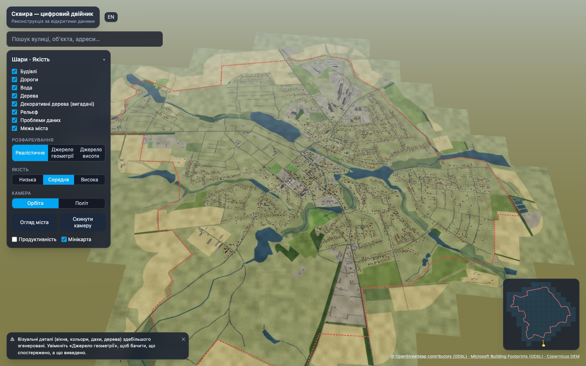

| Close-up with street readout | Building metadata with provenance | Data-quality mode |
|---|---|---|
| 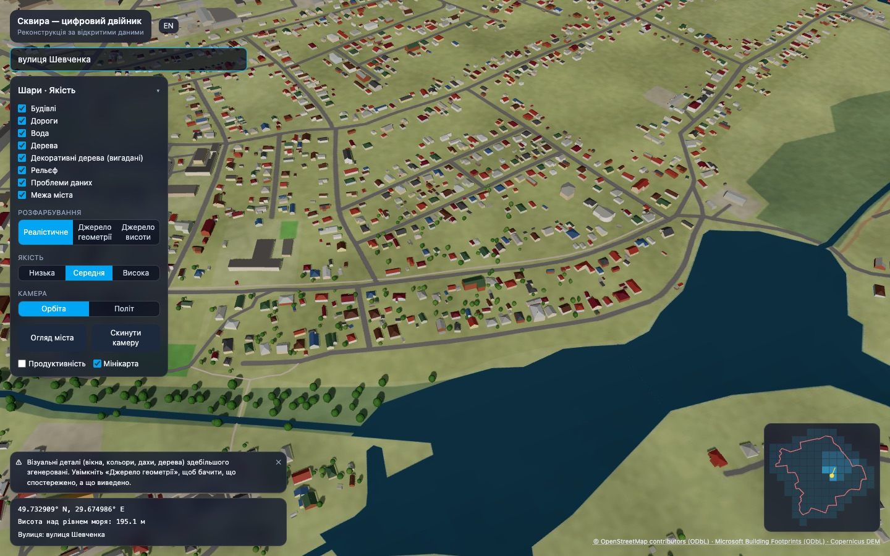 | 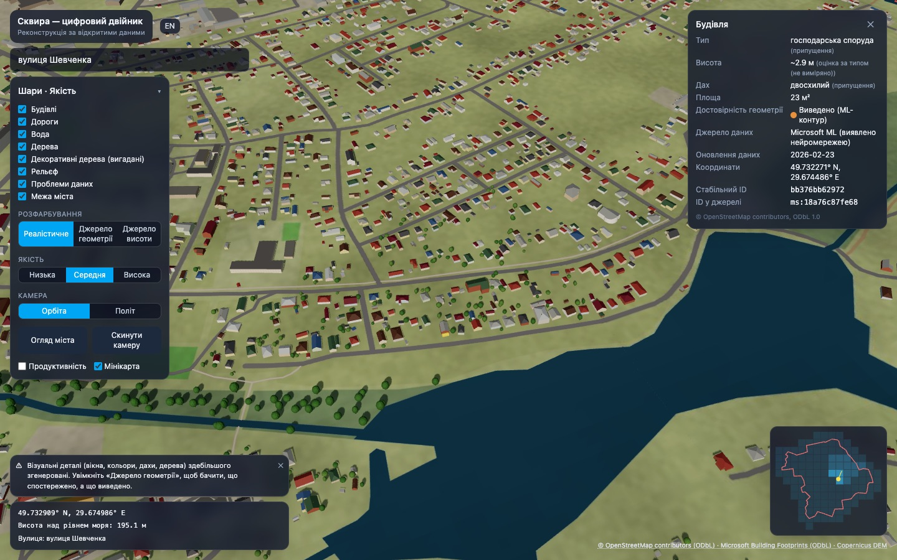 | 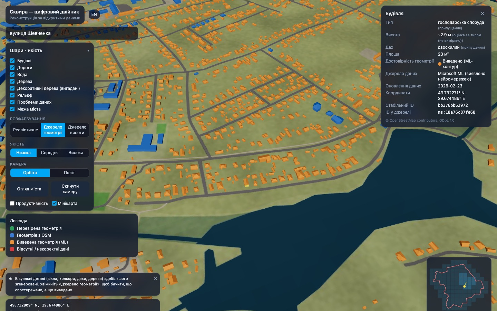 |

| Blender Cycles, sunset (centre) | Blender Cycles, private sector | Night preset |
|---|---|---|
| 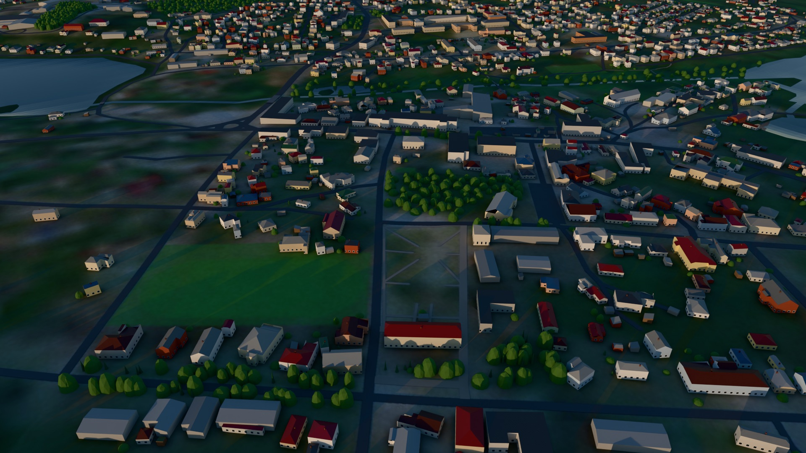 | 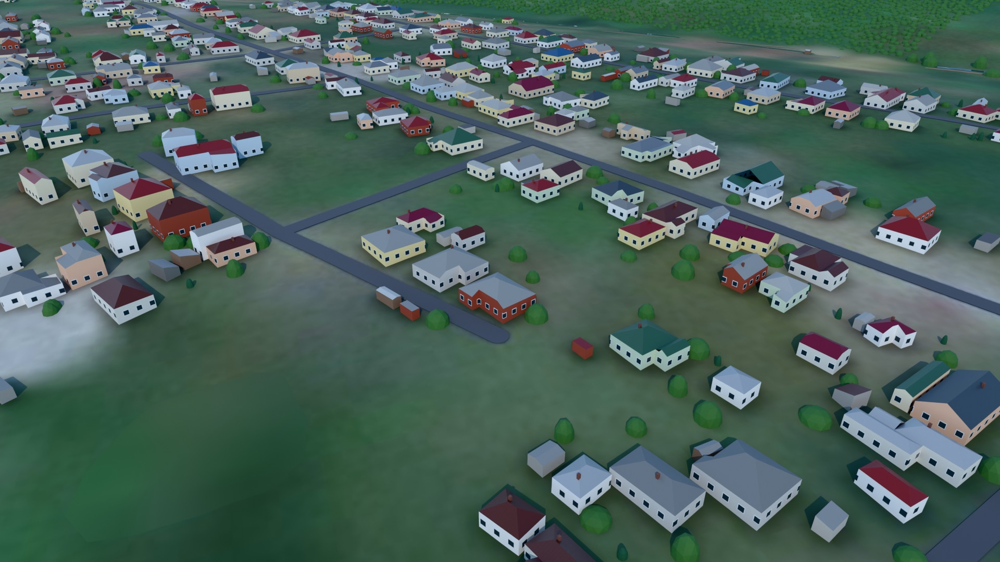 | 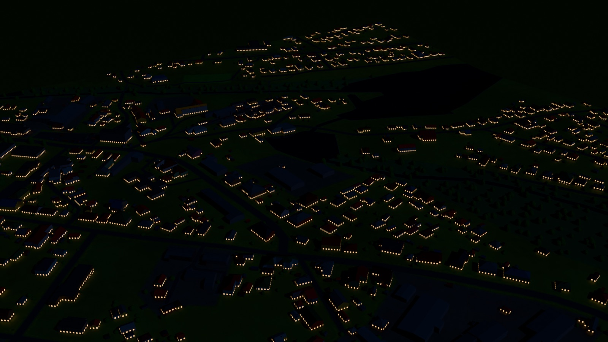 |

Realism & Authenticity 3.0 — real trees from a canopy height model and the lyceum's domed corner tower
(16 viewer pairs in `docs/img/vf3/`, details in [docs/REALISM_3.md](docs/REALISM_3.md)):

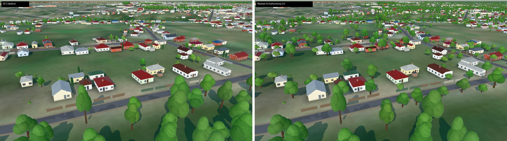
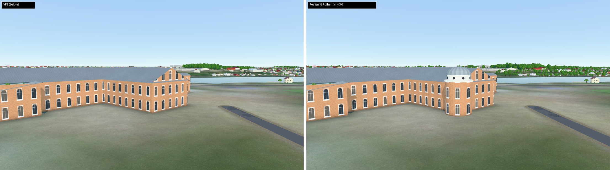
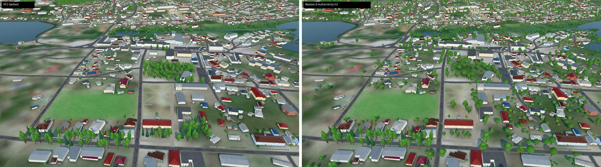

Visual Fidelity 2.0, before → after from identical cameras (13 viewer pairs + 13 Blender pairs in `docs/img/vf2/`):

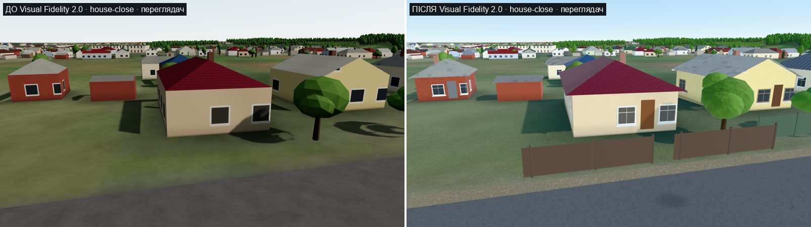
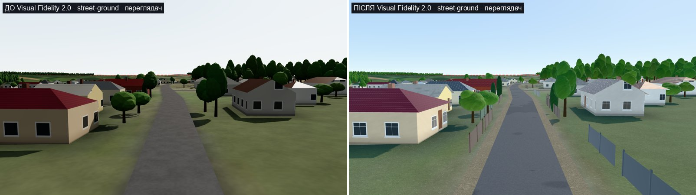
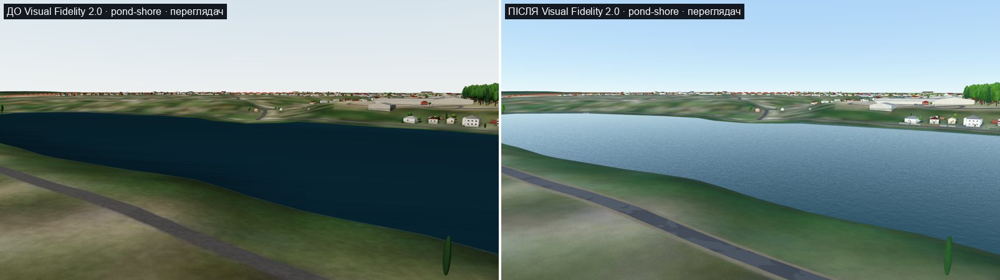

Earlier realism iteration (20 pairs in `docs/img/compare/`):

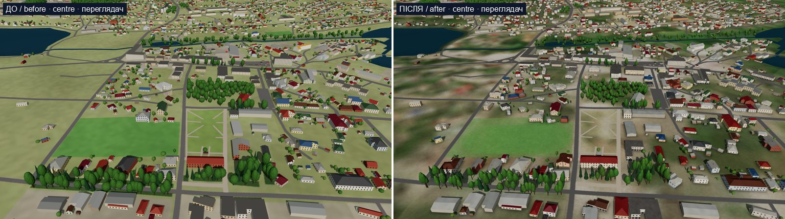
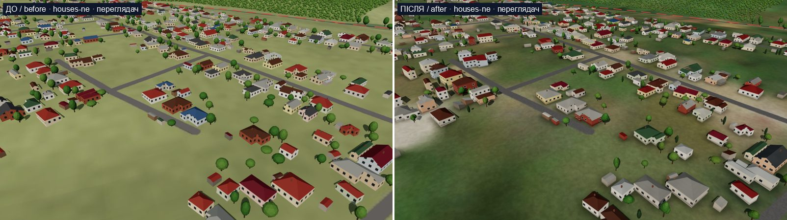
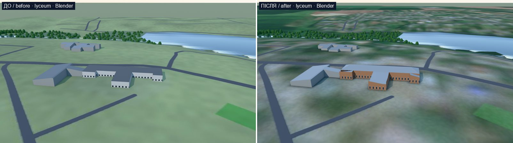

## What is in the model (inside the 17.22 km² OSM town boundary)

| | |
|---|---|
| Buildings | **7,989** — 1,878 hand-mapped in OpenStreetMap (blue in data mode) + 6,111 Microsoft ML footprints filling OSM gaps (orange, *inferred*); 0 generated |
| Heights | 1 measured, 8 from OSM storeys, 1 photo estimate, 96 large non-residential buildings from GHSL satellite data (low confidence), 98.6 % documented type defaults — every building shows its method and confidence |
| Roofs | 0 known from data; all inferred by documented rules (6 families, 732 multi-part roofs on complex plans); materials and colours from photo-based style rules |
| Ground | real colours from Sentinel-2 (18 July 2026, 10 m); terrain = Copernicus DSM corrected to an approximate DTM under buildings and woodland |
| Trees | 50,569: 23,514 (46 %) with position and height from observed data (Meta/WRI canopy height model, imagery 2011/2015, segmented into crowns; 45 OSM-mapped), the rest by land-cover rules where that model is unreliable (model fill, outdated vs ESA WorldCover 2021, orchards mapped after 2015) or in the switchable decorative layer |
| Landmarks | 4 listed buildings matched via Wikidata; 2 with photo-estimated attributes (Commons, CC BY-SA); the lyceum's domed corner tower modelled from photos (dimensions estimated) |
| Streets | 118.5 km, 108 named streets, 13 bridge segments |
| Terrain | Copernicus GLO-30 (30 m), 181–248 m above sea level |
| Style rules | docs/ARCHITECTURE_STYLE.md (sources and observations) |
| Alignment check | OSM vs ML outlines: median 0.82 m apart, no systematic offset |
| Known gaps | 23 % of residential street length has no building in either source; heights are estimates |

Read [docs/GEOGRAPHIC_ACCURACY.md](docs/GEOGRAPHIC_ACCURACY.md) before trusting any detail.

## Quick start

Needs Python ≥ 3.12 and Node ≥ 20.19 (tested: Python 3.14.2, Node 25.2.1, macOS). Optional: Blender ≥ 4.2
(tested 5.2.3 LTS) for renders, Google Chrome for e2e tests, ffmpeg for the flyover. No system GIS libraries,
API keys or accounts.

```bash
make setup          # Python venv (wheels bundle GEOS/PROJ/GDAL) + web dependencies
make env            # verify the environment
make acquire        # ~28 MB: OSM (Overpass), Microsoft footprints, Copernicus DEM, Sentinel-2, GHSL, canopy height, WorldCover windows
make validate       # normalize + coverage audit + diagnostic maps (docs/img)
make build          # all 119 tiles × 3 LODs (~200 MB in assets/generated), ~15 s with 6 workers
make qa             # geometry QA, must exit 0
make web-dev        # http://127.0.0.1:5199
```

`make acquire` fetches the *current* OpenStreetMap data, so building and street counts can differ slightly
from the figures below (snapshot of 2026-11-12); the Sentinel-2 scene and the other sources are pinned in
`config/city.json`. Checksums of what was downloaded go to `data/raw/manifest.json`.

The interface is Ukrainian by default (EN button switches). Orbit: left-drag pan, right-drag rotate,
wheel zoom to cursor. Fly mode: WASD, Q/E down/up, Shift faster, drag to look. Click a building for its
metadata; the *Розфарбування* control switches to geometry-source / height-source colouring (in the geometry-source
mode trees are coloured by provenance too: teal canopy model, blue OSM, orange rule-based).

## Commands

| Task | Command |
|---|---|
| Environment verification | `make env` |
| Data acquisition (network) / verify cache only | `make acquire` / `make acquire-offline` |
| Data validation + audit + 2D maps | `make validate` |
| Preview tiles (3×3 centre) / full city | `make preview` / `make build` |
| Whole pipeline from cache | `make all` |
| Cinematic still (Cycles) / flyover mp4 (Eevee) | `make render` / `make flyover` |
| Editable `.blend` of the whole city | `make export` |
| Web dev server / production build | `make web-dev` / `make web-build` |
| Unit / integration / web unit+typecheck / e2e | `make test-unit` / `make test-integration` / `make test-web` / `make e2e` |
| Performance benchmark | `make bench` |
| Before/after renders from fixed viewpoints | `scripts/compare_renders.sh <label>` |

Stages are restartable (`PYTHONPATH=pipeline .venv/bin/python -m skvyra.cli <stage>`), with `--offline`,
`--refresh`, `--tiles <ids>`, `--force`, `--workers N`. `SKVYRA_DEBUG=1` prints full tracebacks.

## Corrections

Put verified facts in `data/overrides/overrides.json` (format in `pipeline/skvyra/overrides.py`), keyed
by the *ID у джерелі* shown in the info panel, e.g.

```json
{"version": 1, "buildings": {"osm:way/123456": {"levels": 2, "roof_shape": "hipped", "verified": true,
  "note": "own photo 2026-11", "anchor": [29.6629, 49.7298]}}}
```

Rebuild: only the affected tile changes. Overrides that no longer match a feature are reported in
`data/processed/overrides_report.json`, never dropped.

## Status (2026-11-14, after Realism & Authenticity 3.0)

| Check | Result |
|---|---|
| Tile build (`build --force`) | 119 / 119 tiles, 0 failed, 17 s |
| Geometry QA (`make qa`) | 0 floating, 0 buried, 0 road/building overlaps, 0 trees in buildings, 0 surfaces facing down; 13 low uphill walls (real slopes), 1 height outlier |
| Python tests | 122 passed (incl. canopy segmentation, trust masks, tower geometry, synthetic CHM end-to-end) |
| TypeScript unit tests (vitest) | 34 passed |
| Typecheck (`tsc --noEmit`) | 0 errors |
| Browser e2e (Playwright) | 6 passed, 2 on-demand skipped (benchmark, compare) |
| Production build (`vite build`) | OK — JS 1.36 MB (382 KB gzip); `dist/` 229 MB incl. tiles |
| Performance | see docs/PERFORMANCE.md — M4 Pro only; 3.0 adds ~0–5 ms p99 in tree-heavy views (paired runs under external load), CPU-throttled profile without regression in static views; weak GPUs not measured |

Best before/after pairs (3.0): `docs/img/vf3/web-yards-sw.jpg`, `web-houses-ne.jpg`, `web-lyceum-tower.jpg`,
`web-park.jpg`, `web-centre.jpg`. Visual Fidelity 2.0: `docs/img/vf2/web-house-close.jpg`, `web-pond-shore.jpg`.

## Audits

[AUDIT_REPORT](docs/AUDIT_REPORT.md) (data, licences, geometry QA, landmarks, performance) ·
[VISUAL_FIDELITY](docs/VISUAL_FIDELITY.md) · [REALISM_3](docs/REALISM_3.md) · [LICENSES](docs/LICENSES.md) · `make qa` for geometry checks.

## Documentation

[ARCHITECTURE](docs/ARCHITECTURE.md) · [ENVIRONMENT_AUDIT](docs/ENVIRONMENT_AUDIT.md) ·
[DATA_SOURCE_AUDIT](docs/DATA_SOURCE_AUDIT.md) · [GEOGRAPHIC_ACCURACY](docs/GEOGRAPHIC_ACCURACY.md) ·
[PIPELINE](docs/PIPELINE.md) · [PERFORMANCE](docs/PERFORMANCE.md) · [LIMITATIONS](docs/LIMITATIONS.md) ·
[ROADMAP](docs/ROADMAP.md) · [PROGRESS](docs/PROGRESS.md)

## Data licences and attribution

- © OpenStreetMap contributors, ODbL 1.0 — https://www.openstreetmap.org/copyright
- Microsoft Global ML Building Footprints, CDLA Permissive 2.0 — https://github.com/microsoft/GlobalMLBuildingFootprints
- Terrain produced using Copernicus WorldDEM-30 © DLR e.V. 2010-2014 and © Airbus Defence and Space GmbH 2014-2018 provided under
  COPERNICUS by the European Union and ESA; all rights reserved.
- Contains modified Copernicus Sentinel data 2026 (scene S2C_35UPR_20260718).
- GHSL GHS-BUILT-H R2023A © European Union 1995-2026, CC BY 4.0 (JRC).
- Trees: High Resolution Canopy Height Maps v2 © Meta and World Resources Institute (WRI), CC BY 4.0; changes made
  (tree segmentation). Land cover check: © ESA WorldCover project 2021 / Contains modified Copernicus Sentinel data
  (2021) processed by ESA WorldCover consortium, CC BY 4.0.
- Landmark coordinates: Wikidata (CC0). Style references: Wikimedia Commons photos (CC BY-SA, authors on the
  linked file pages) — referenced, not redistributed.

Licence compatibility and what may be published: see docs/LICENSES.md. Nothing
here uses Google, Bing, Esri or other proprietary imagery or 3D data. Sensitive features (military,
security infrastructure) are excluded by the pipeline. The project is local-only; nothing has been
published or deployed.
